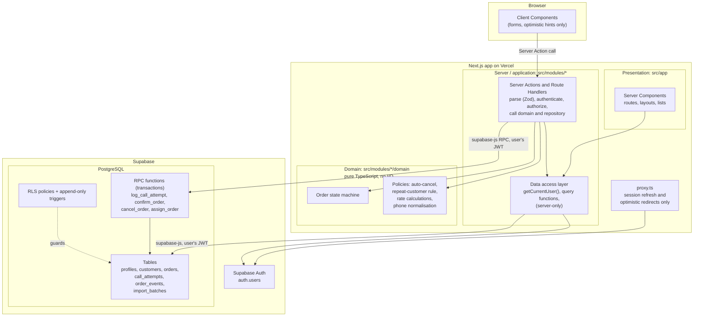
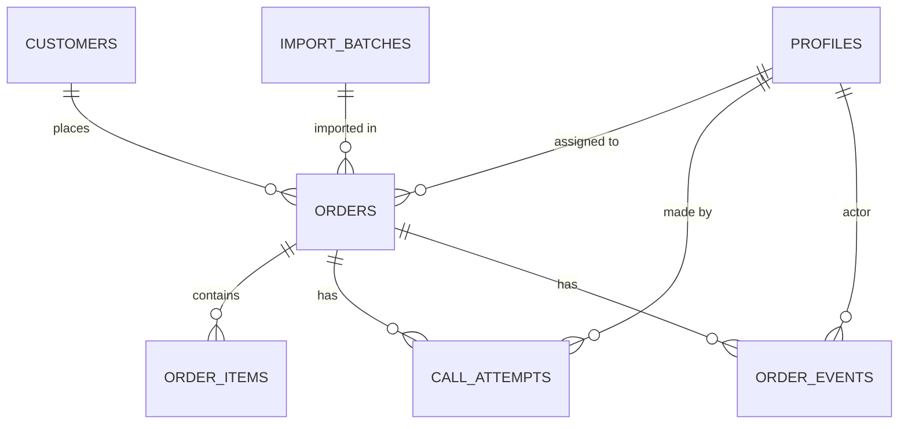
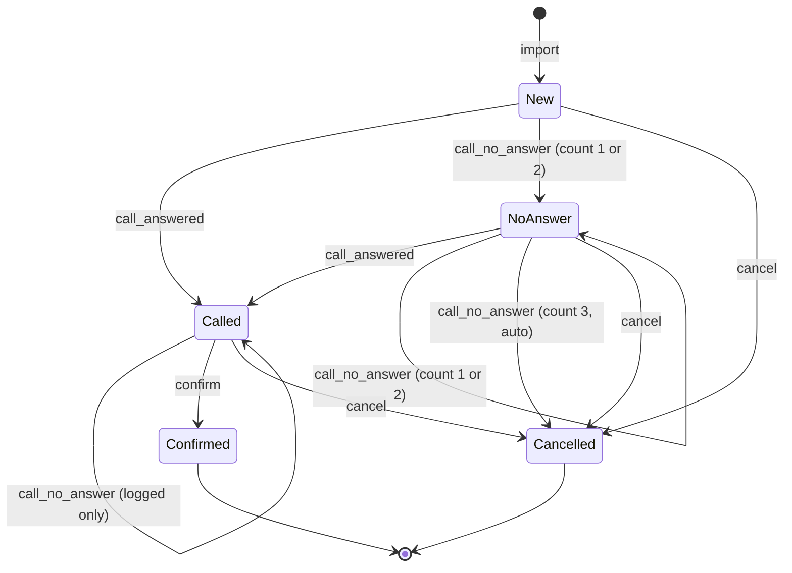
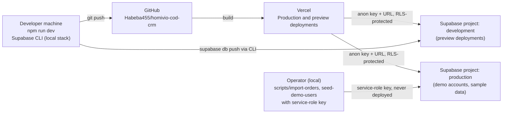

# Homivio COD Order Confirmation CRM — Architecture

Status: **Planning document (Phase 1, Step 3), updated after verifying `sample_orders.json`.** No application logic, migrations, or tables exist yet. Everything below is the design that later phases will implement. Where the design depends on information not yet available, it is marked **Pending verification** and listed in [Open questions and assumptions](#14-open-questions-and-assumptions).

---

## 1. Project overview

An internal CRM that lets an operations team confirm Cash-on-Delivery (COD) orders by phone.

- **Admins** import orders, assign them to agents, see all orders, and review confirmation rates.
- **Agents** see only the orders assigned to them, log call attempts and notes, and move orders through the confirmation workflow.
- Every status change and every call attempt is recorded in an append-only audit history.
- The system warns the agent when a customer has a history of cancelled or refused orders.

The verified sample dataset is 50 Moroccan COD orders: 44 active orders in the confirmation pipeline and 6 historical orders with final statuses, linked to active orders by phone number (§8).

The assessment is a three-day exercise. The architecture is therefore a **modular monolith** on a single Next.js app with a single Postgres database. It favours a small number of well-understood mechanisms (SQL transactions, RLS, Zod validation, pure domain functions) over frameworks and patterns that would add weight without adding safety.

### Scope of this document

In scope: architecture, module boundaries, security model, data integrity, conceptual schema, state machine, testing, deployment, and planning.

Out of scope for this step: login pages, Supabase tables, order APIs, dashboard components, business logic, the Smart Operations Queue, and new dependencies. No code in this step depends on those items.

---

## 2. Technology decisions

| Area | Choice | Why | Alternatives considered |
|---|---|---|---|
| Framework | Next.js 16.4.5 App Router, Turbopack | Already in the repository. Server Components and Server Actions keep data access on the server by default. | Separate API server + SPA: two deployables and a second auth surface for no gain at this size. |
| UI | React 19.3, Tailwind CSS 4 | Already in the repository. | — |
| Config | `cacheComponents: true`, `partialPrefetching: true` | Already enabled. Kept as-is. The auth and cache rules in [Section 7](#7-security-model) are designed around them. | Disabling them would remove the reason the project was set up on Next 16. Not recommended. |
| Database | Supabase PostgreSQL | Transactions, constraints, triggers, and Row Level Security (RLS) are all needed for the integrity requirements. | Firebase or a document store: weak fit for relational constraints and transactional state changes. |
| Auth | Supabase Auth with cookie sessions via `@supabase/ssr` (**to add in a later phase**) | Integrates with RLS through `auth.uid()`. `@supabase/ssr` is the supported way to read session cookies in App Router. | Custom JWT/session code: more security surface to own. NextAuth: a second identity layer on top of Postgres RLS. |
| Data access | `@supabase/supabase-js` calling tables and RPCs | RLS applies automatically to user-scoped requests. Avoids a separate ORM and its connection handling in serverless. | Prisma/Drizzle: would need a service-role connection that bypasses RLS, which moves authorization out of the database. Revisit only if the query surface grows much larger. |
| Validation | Zod (**to add in a later phase**) | One schema per input, used for forms, Server Actions, Route Handlers, and the JSON import. | Hand-written checks: easy to miss a field. |
| Tests | Vitest (**to add in a later phase**) | Fast, TypeScript-native. Used for pure domain logic and for integration tests against a local Supabase. | Jest: heavier config for the same result. |
| Hosting | Vercel for the app, Supabase for database and auth | Native Next.js hosting. Preview deployments per branch. | Self-hosting: more operational work for no assessment benefit. |

### Packages to add later (not installed in this step)

| Package | Purpose | Phase |
|---|---|---|
| `@supabase/supabase-js` | Database and auth client | I-1 |
| `@supabase/ssr` | Cookie-based session handling in App Router | I-1 |
| `zod` | Input validation | I-1 |
| `vitest` | Unit and integration tests | I-1 |
| `server-only` (optional) | Build-time guard against importing server modules into client code. Next.js handles this internally, so it is only needed if lint rules flag it. | I-1, if needed |

### Deliberately not used

- **Microservices, message queues, and an event bus.** The workload is one team on one database.
- **An ORM.** SQL functions and RLS policies are the core of the integrity design, and they are clearer in SQL. Generated database types from Supabase give typed queries.
- **A global state library.** Server Components render from the database. Client state is limited to forms.
- **Repository and CQRS patterns.** One repository module per feature is enough.
- **A separate authorization library.** Roles and ownership are simple enough to express in RLS and a few typed guard functions.

---

## 3. Architecture diagram



The key property of the diagram is that **the database enforces the rules that matter most** (who can see a row, and whether a transition is allowed). The application layer makes the same checks earlier so it can return clear errors, but it is not the last line of defence.

---

## 4. Layer responsibilities

### 4.1 Presentation layer (`src/app`)

- Routes, layouts, and Server Components that render lists and detail pages.
- Client Components only for interactive pieces: forms, confirmation dialogs, and assignment dropdowns. They call Server Actions and never call the database directly.
- Presentation may hide UI that a role cannot use. **Hiding is cosmetic.** Every action re-checks the role on the server.
- Does not import `supabase` clients, domain transition functions, or Zod schemas directly. It goes through the application layer.

### 4.2 Server / application layer (`src/modules/<feature>/actions.ts`, `queries.ts`)

- **`queries.ts`** (`server-only`): read functions used by Server Components. They call `getCurrentUser()`, then query through the data-access functions.
- **`actions.ts`** (`'use server'`): mutations. Each action runs the same sequence:
  1. Resolve the session and the role on the server (`getCurrentUser()`).
  2. Parse the input with a Zod schema.
  3. Perform a coarse authorization check (for example, "is the caller an admin?").
  4. Call a domain policy function if one applies (for example, "is this transition allowed from the current status?").
  5. Call the RPC through the repository, passing the expected version and an idempotency key.
  6. Invalidate caches and return a typed result (`{ ok: true, data } | { ok: false, error }`).
- Actions contain no SQL and no state-machine logic. They orchestrate.

### 4.3 Domain layer (`src/modules/<feature>/domain`)

- Pure TypeScript functions with no imports from Next.js, Supabase, or the network.
- Owns the rules that should be easy to read and unit test:
  - the order state machine (`transition(status, event, context)`),
  - the auto-cancel policy (three unanswered attempts),
  - the repeat-customer rule,
  - confirmation-rate arithmetic,
  - phone normalisation used as the customer identity key.
- **The database is the source of truth for transitions** (see [Section 9](#9-data-integrity-strategy)). The domain module mirrors the same table so the UI can show what is allowed and so the rules can be tested without a database. A shared fixture test keeps the two in step.

### 4.4 Database / data-access layer (`src/modules/<feature>/repository.ts`, `src/lib/supabase/*`)

- The only code that knows table, column, or RPC names.
- Maps rows to domain types and back.
- Two Supabase clients:
  - **Request-scoped client** (cookies and the user's JWT): used for all reads and for all mutations. RLS applies.
  - **Service-role client**: used only by the one-off import and seed scripts run by an operator. It is never created in a request path and never reaches the browser.

### 4.5 Database (Postgres, managed by Supabase)

- Tables, enums, check constraints, unique keys, and indexes.
- RLS policies for every table in the exposed schema.
- Transactional RPC functions for every state change.
- Triggers that reject `UPDATE` and `DELETE` on audit tables.

---

## 5. Data flow

### 5.1 Example: an agent logs an unanswered call

```mermaid
sequenceDiagram
    autonumber
    participant A as Agent browser
    participant SA as Server Action
    participant DAL as getCurrentUser (uncached, request-time)
    participant D as Domain policy
    participant DB as Postgres RPC log_call_attempt
    A->>SA: submit(orderId, expectedVersion, outcome, note, idempotencyKey)
    SA->>DAL: resolve session and role
    DAL-->>SA: { id, role: agent }
    SA->>SA: Zod parse input
    SA->>DB: rpc log_call_attempt(... , auth.uid() via JWT)
    Note over DB: 1. Begin transaction<br/>2. Return stored result if idempotency key exists<br/>3. SELECT ... FOR UPDATE on order (RLS applies)<br/>4. Reject if version differs (conflict)<br/>5. Check assignment and status transition<br/>6. Insert call_attempts row (append-only)<br/>7. Increment unanswered count; auto-cancel at 3<br/>8. Update status and version<br/>9. Insert order_events row<br/>10. Commit
    DB-->>SA: { status, version, autoCancelled }
    SA->>SA: updateTag / revalidate affected views
    SA-->>A: typed result
```

Points to note:

- The **domain policy** runs in the action as an early check so the agent gets a readable message. The **RPC** repeats the decision inside the transaction so that a concurrent change cannot slip through.
- The **RLS** policy on `orders` means the RPC cannot lock or update a row the agent is not assigned to, even if the action had a bug.

### 5.2 Read path

1. A Server Component renders inside a `<Suspense>` boundary.
2. It calls a function in `queries.ts`.
3. That function calls `getCurrentUser()` and then queries through the request-scoped client.
4. RLS limits the rows returned. The query does not add a filter for the role; the database does.

### 5.3 Import path (operator-run, idempotent)

1. The operator runs `scripts/import-orders.ts` locally with the service-role key. The key is never deployed.
2. The script reads the file as UTF-8 and computes its SHA-256. If `import_batches` already holds that checksum, the script exits with "already imported" and writes nothing.
3. Zod validates the whole file. The top level must be `{ orders: [...] }` with exactly 50 rows (configurable). Each row must match §8.1. The checks are: `total = subtotal + shipping_fee`; `subtotal = sum(quantity × unit_price)`; `source_status` is one of the four known values; `id` is unique; each phone normalises to `+212…` (§8.5). Any failure rejects the whole file and lists every row error. Nothing is written.
4. The script maps each row. `new` maps to pipeline `New`. `delivered`, `refused` and `cancelled` map to pipeline NULL (§8.2).
5. One transaction runs through an RPC, `import_source_orders`, which only the service role may call:
   - insert `import_batches`;
   - upsert `customers` by `phone_e164`;
   - insert `orders` with `ON CONFLICT (source_order_id) DO NOTHING`;
   - if an existing ID has a different `source_payload_sha256`, abort the whole transaction, because changed source data is an error and not an update;
   - insert `order_items`;
   - insert one `imported` event per new order, and none for historical orders.
6. The script reports the counts: 50 orders, 44 in the pipeline, 6 historical, 44 customers, 80 order items, and 44 `imported` events.

## 6. Module responsibilities

Proposed structure. Folders are created in the phase that first needs them, not now (see [implementation-plan.md](./implementation-plan.md)).

```
src/
  app/                              Presentation (routes, layouts, pages)
    (auth)/login/                  Phase I-4
    (dashboard)/orders/            Phase I-6
    (dashboard)/admin/analytics/   Phase I-7
  lib/
    env.ts                         Validated environment (server-only)
    supabase/
      server.ts                    Request-scoped client (cookies)
      admin.ts                     Service-role client (scripts only)
      proxy-session.ts             Session refresh helper used by proxy.ts
  modules/
    auth/                          Authentication and authorization
      session.ts                   getCurrentUser() (uncached; React cache() per request)
      guards.ts                    requireRole(), requireAdmin()
      domain/roles.ts              Role type and permission table
    orders/                        Orders core
      domain/status.ts             State machine
      domain/transitions.ts        Event -> next status, with context
      repository.ts                Read/write via RPC and tables
      queries.ts                   Server-only read functions
      source-import.ts            Source status mapping and row validation (§8.2, §8.5)
      actions.ts                   Server Actions
      schemas.ts                   Zod schemas
    assignment/                    Agent assignment
      actions.ts                   assign_order via RPC
      domain/policy.ts            Who may be assigned what
    call-attempts/                 Call attempts and notes
      domain/auto-cancel.ts       Three-unanswered-attempts rule
      repository.ts
      actions.ts
      schemas.ts
    audit/                         Audit history (read-only)
      queries.ts
      domain/format.ts            Human-readable event text
    repeat-customers/             Repeat-customer warning
      domain/phone.ts             Phone normalisation
      domain/risk.ts              Repeat-customer rule
      queries.ts
    analytics/                     Confirmation rates
      domain/rates.ts             Rate arithmetic, date range handling
      queries.ts
    smart-ops/                     Optional, out of scope
  
supabase/                          Versioned SQL (added in I-3)
  migrations/
  tests/                           pgTAP or SQL integration tests (I-3, I-4)

scripts/
  import-orders.ts                 Operator-run import (service role)
  seed-demo-users.ts               Demo accounts (service role)
```

### Responsibilities at a glance

| Module | Owns | Does not own |
|---|---|---|
| `auth` | Session resolution, role lookup, guards | Passwords (Supabase Auth owns them) |
| `orders` | Order reads, state machine, status-change action | Call-attempt rules (delegated to `call-attempts`) |
| `assignment` | Admin assignment, reassignment rules | Who an agent is (that is `profiles`) |
| `call-attempts` | Logging attempts and notes, auto-cancel | Status enum itself (owned by `orders/domain`) |
| `audit` | Read-only history views | Writing events (only RPCs write them) |
| `repeat-customers` | Phone normalisation, prior-history lookup and warning | Customer creation (import and RPC do that) |
| `analytics` | Rate queries and arithmetic | Raw event storage |
| `smart-ops` | Nothing yet | Entire feature is out of scope for this step |

Each module exposes what other modules need through its `index.ts` (where needed). Cross-module imports go to a module's public surface, not its internal `domain` files.

---

## 7. Security model

### 7.1 Authenticated server-side access

- Every Server Action, Route Handler, and Server Component query starts with `getCurrentUser()`, which resolves the Supabase session from cookies and returns `null` for anonymous callers. Callers redirect or return an error on `null`.
- The Supabase session is validated server-side with Supabase Auth on each resolution. Client-supplied tokens are not trusted without validation.
- `proxy.ts` (the Next.js 16 file convention for request interception, documented under `node_modules/next/dist/docs/01-app/03-api-reference/03-file-conventions/proxy.md`) is used for **session refresh and optimistic redirects only**. It is not the authorization boundary, because the page or action it protects can be reached in other ways. Authorization happens in the data-access layer and in RLS.

### 7.2 Admin and Agent roles

- Roles live in a `profiles` table keyed by `auth.users.id`, with a `role` enum (`admin` | `agent`) and `is_active`.
- **Roles are never read from `user_metadata` or from the JWT's custom claims that a user can edit.** `user_metadata` is writable by the user in Supabase, so it cannot be a trust source.
- The role is read from `profiles` on the server, in `getCurrentUser()`. RLS policies also read `profiles` (via a `security definer` helper, or a direct subquery with the owner restricted) so the database and the app agree.
- Admin accounts are created by an operator script. There is no self-registration as admin.

### 7.3 Per-order ownership

- `orders.assigned_agent_id` is the ownership field.
- Agents may read and act on orders where `assigned_agent_id = auth.uid()`.
- Admins may read and act on all orders.
- Unassigned orders are visible to admins only.
- A call attempt is recorded with `agent_id = auth.uid()`, not with a value the client sends.

### 7.4 Row Level Security

- RLS is enabled on every table in the exposed schema, with no exceptions.
- **Direct `UPDATE` on `orders` is revoked from `authenticated`.** Status and assignment changes happen only through RPCs. This means an agent cannot change `status` or `assigned_agent_id` with a crafted REST request, even if the RLS `UPDATE` policy would otherwise allow the row.
- `call_attempts` and `order_events` have `SELECT` and `INSERT` policies only (insert through RPC). No `UPDATE` or `DELETE` policy exists, and triggers reject both (see Section 9).
- The repeat-customer check needs to know that a *customer* has a prior cancelled order, even when that order belongs to another agent. To avoid exposing other agents' orders, this is done with a narrow `security definer` function that returns only `{ prior_cancelled_count, prior_refused_count }` for a given customer. It returns no other fields and no other order identifiers. The function sets `search_path` explicitly.
- RPCs default to `security invoker`, so RLS applies to them. `security definer` is used only where the narrow scope above requires it, and every such function re-checks `auth.uid()` and role before doing anything.

### 7.5 Secure use of Supabase credentials

| Credential | Where it may be used | Exposure rule |
|---|---|---|
| Project URL | Client and server | Public by design |
| Publishable (anon) key | Client and server, with RLS | Public by design. Safe only because RLS is enabled everywhere. |
| Service-role key | Operator scripts only (`scripts/`), run locally or in a controlled CI job | Never prefixed `NEXT_PUBLIC_`. Never imported from `src/`. Never read in a request path. |
| Database connection string | Migrations only (Supabase CLI) | Not in the app runtime. |

- Environment variables are validated in `src/lib/env.ts`, which imports `server-only`, so a server secret used in a client module fails the build.
- `.env*` is already ignored by `.gitignore`. Only an `.env.example` with placeholder names is committed.

### 7.6 Input validation

- Every external input is parsed with Zod at its entry point: form data, Server Action arguments, Route Handler bodies and query strings, and the JSON import file.
- Parsing is strict (unknown keys rejected in mutation schemas).
- Route and query parameters, such as `orderId` and date ranges, are validated before use. Date ranges are bounded (for example, a maximum span) to keep queries cheap.
- Validated output is what the domain and repository receive. Raw `FormData` never crosses into the domain.
- Error messages returned to clients are generic for authorization failures and specific for validation failures. They never include other users' data.

### 7.7 Cache Components and Partial Prefetching with user-specific data

The Next.js guides in this repository state the constraints this design follows. Specifically, from `node_modules/next/dist/docs/01-app/02-guides/authentication-with-cache-components.md`:

- A session read happens at request time and cannot be part of the static shell. Components that read it must sit behind `<Suspense>`. Reading `cookies()` outside a boundary is a build error.
- `use cache: private` is the scope that can read `cookies()` and keeps its result in the browser only.
- A plain `use cache` scope cannot read `cookies()`. Cached function arguments and `cacheTag` values are stored as plain text, so they must not contain personal data or secrets.

Applied to this app:

| Data | Strategy | Reason |
|---|---|---|
| Current user, role, and ownership (`getCurrentUser()`) | Not cached. Read at request time behind `<Suspense>`. React `cache()` deduplicates within one request only. | Authorization must reflect the current session and role on every request. A cached role could outlive a demotion or deactivation, and a shared entry could leak across users. |
| Order lists, order detail, audit history, call attempts | Not cached in v1. Read on each request behind `<Suspense>`. | Data changes often and is user-scoped. The cost is acceptable at this scale, and it removes a class of stale-data and cross-user bugs. |
| Analytics | Not cached in v1. If caching is added later, the key must include the viewer's id and role and the filters, and the function must be tagged for `updateTag`. | Admin-only numbers cached globally could be served to an agent. |
| Layout chrome and static copy | May prerender into the static shell | Contains no user data. |
| Repeat-customer warning | Not cached | Depends on the current order and customer state. |
| Partial prefetching (`partialPrefetching: true`) | Keep enabled. Do not set `prefetch={true}` on order links by default. Use it only where an agent is likely to open a specific order next. | Each prefetch costs a server invocation. Prefetched authenticated content is per session and is cleared on logout, so the logout flow must call `router.refresh()` or redirect after clearing the session. |

Rules that follow:

1. Do not put user-specific values in a plain `use cache` function unless they are passed as arguments that identify the user, and do not cache role-dependent results without the viewer's id in the key.
2. Re-check the session in every Server Action. `getCurrentUser()` is uncached, so each write is authorized against the session at the moment it happens.
3. Do not disable `cacheComponents` or `partialPrefetching` to simplify auth. If a specific route cannot be prerendered, use `instant = false` on that route as the Next.js guide describes, and record the reason.

---

## 8. Source dataset and conceptual database design

This section is grounded in the verified file `sample_orders.json` (uploaded as `80625038-sample_orders.json`). The earlier "pending verification" status is resolved.

### 8.1 Verified source dataset

The file was checked by a script that ran separately from the earlier review.

- Size 38,351 bytes, UTF-8, no byte-order mark.
- SHA-256 `4a51cb270eb99aa1ea1e0b3c9a5bafa9d8198834aae888def536b0682995cdd4`. The import uses this as its batch key.
- A single top-level object with one key, `orders`, holding 50 objects.

Schema, as observed:

| Path | Type | Presence | Notes |
|---|---|---|---|
| `id` | string | required | `BRX-` plus 4 digits, `BRX-1001` to `BRX-1050`, unique and sequential |
| `created_at` | string | required | ISO 8601 with seconds and a `+01:00` offset on all 50 |
| `customer.name` | string | required | 43 distinct names; each phone always has the same name |
| `customer.phone` | string | required | `+212` followed by 9 digits; all begin with `6` after the country code |
| `shipping_address.city` | string | required | 12 cities; some unaccented (`Sale`, `Fes`, `Tetouan`), stored as given |
| `shipping_address.district` | string | required | Free text |
| `shipping_address.address1` | string | required | Free text, may contain `n°` and accents |
| `line_items[].sku` | string | required | 10 SKUs, `BRX-001` to `BRX-010`, one title and one price each |
| `line_items[].title` | string | required | French, with accents and `°` |
| `line_items[].quantity` | int | required | Values are 1 or 2 only |
| `line_items[].unit_price` | int | required | MAD, whole numbers |
| `subtotal` | int | required | Equals the sum of quantity × unit_price on all 50 |
| `shipping_fee` | int | required | 0 on 29 orders, 30 on 21 orders |
| `total` | int | required | Equals subtotal + shipping_fee on all 50 |
| `currency` | string | required | `MAD` on all 50 |
| `payment_method` | string | required | `COD` on all 50 |
| `status` | string | required | `new` 44, `delivered` 2, `refused` 2, `cancelled` 2 |
| `history_note` | string | optional | Present on exactly the 6 non-new orders. It is a test-data marker, not business data. Classification uses `status`, never this note. |

Facts verified by the script:

- 50 orders with unique IDs. Two key shapes exist: 44 orders without `history_note`, and 6 with it.
- Every `created_at` carries a `+01:00` offset. Historical orders were created 2026-09-09 to 2026-09-20, and new orders 2026-10-20 to 2026-10-29. IDs increase with `created_at`.
- Money: all amounts are whole MAD values. Subtotals and totals reconcile on every order. Totals are 18,573 MAD across all 50 orders and 16,185 MAD across the 44 new orders.
- Shipping: the observed rule is free shipping at subtotals of 318 MAD and above, and a 30 MAD fee at 278 MAD and below. No value falls between 279 and 317, so the exact threshold is observed, not documented. No CRM logic depends on it.
- Line items: 80 in total. 27 orders have one line, 16 have two, and 7 have three. Each of the 10 SKUs has exactly one title and one price across all orders.
- Phones: 44 distinct numbers across 50 orders. Six numbers appear twice, and each of those pairs is one historical order plus one new order (§8.2).
- Text: addresses use `n°`, and product titles contain accents and `°`. Store and compare as UTF-8.

### 8.2 Historical and active orders

The six historical orders share a phone number with a later new order. The later order follows the historical one by 32 to 47 days.

| Historical order | Source status | Created | Phone | Historical city | Later new order | New city |
|---|---|---|---|---|---|---|
| BRX-1001 | delivered | 2026-09-09 | +212600036026 | Rabat | BRX-1020 (2026-10-23) | Oujda |
| BRX-1002 | refused | 2026-09-09 | +212600031781 | Sale | BRX-1035 (2026-10-26) | Fes |
| BRX-1003 | refused | 2026-09-15 | +212600001326 | El Jadida | BRX-1009 (2026-10-20) | Casablanca |
| BRX-1004 | delivered | 2026-09-16 | +212600033890 | Casablanca | BRX-1024 (2026-10-24) | Kenitra |
| BRX-1005 | cancelled | 2026-09-18 | +212600038849 | Tanger | BRX-1037 (2026-10-26) | Oujda |
| BRX-1006 | cancelled | 2026-09-20 | +212600018495 | Sale | BRX-1018 (2026-10-22) | Tanger |

Strategy: historical records are a source snapshot. They are stored as data and never enter the confirmation workflow.

| `source_status` | `pipeline_status` | In the work queue | In analytics | Repeat-customer warning |
|---|---|---|---|---|
| `new` | `New` | Yes | Yes | Only if prior refused or cancelled history exists |
| `delivered` | NULL | No | No | No; shown as neutral history |
| `refused` | NULL | No | No | Yes |
| `cancelled` | NULL | No | No | Yes |

Rules:

1. `source_status` stores the exact value from the file and is never rewritten.
2. `pipeline_status` belongs only to the CRM workflow. Only `new` orders receive `New` at import. `delivered` must not map to `Confirmed`: nothing in the file says the CRM confirmed it, so the CRM must not claim it.
3. The database enforces `(source_status = 'new') = (pipeline_status IS NOT NULL)`. A historical order cannot be given a pipeline status, and an active order cannot lack one.
4. Transition RPCs reject orders whose `pipeline_status` is NULL with `not_in_pipeline`. The queue query filters on `pipeline_status`.
5. Historical orders have no `call_attempts` and no `order_events`. The import itself is recorded once, in `import_batches`. Each of the 44 new orders gets one `imported` event, which is a real action on a pipeline order.
6. Historical orders have no assigned agent, so RLS shows them only to admins. Agents see the repeat-customer summary, which contains counts only.
7. The confirmation rate counts pipeline orders only. Historical outcomes are reported separately, if at all, as source history.

### 8.3 Entities and fields

**`customers`**: `id` uuid PK · `phone_e164` text, unique, not null · `display_name` text, not null, set on first import and not overwritten · `created_at`. Expected rows after import: 44.

**`orders`**:
- `id` uuid PK
- `source_order_id` text, unique, not null. This is the natural idempotency key, for example `BRX-1001`.
- `customer_id` uuid FK → `customers`
- `source_status` text, not null, CHECK in (`new`, `delivered`, `refused`, `cancelled`)
- `pipeline_status` enum (`New`, `No Answer`, `Called`, `Confirmed`, `Cancelled`), nullable
- `assigned_agent_id` uuid, nullable FK → `profiles`
- `shipping_city`, `shipping_district`, `shipping_address1` text, not null, stored as given
- `currency` text, CHECK = `'MAD'`
- `payment_method` text, CHECK = `'COD'`
- `subtotal`, `shipping_fee`, `total` numeric(12,2), not null. CHECK `total = subtotal + shipping_fee` and `subtotal >= 0`.
- `source_created_at` timestamptz, not null, parsed from the offset string
- `source_payload` jsonb, not null: the untouched source object, kept for provenance
- `source_payload_sha256` text, not null: detects a changed re-export of the same ID
- `import_batch_id` uuid FK → `import_batches`
- `version` int, not null, default 1 (optimistic concurrency)
- `unanswered_attempt_count` int, not null, default 0, CHECK ≥ 0
- `cancel_reason` text, nullable
- `confirmed_at`, `cancelled_at` timestamptz, nullable
- `created_at`, `updated_at` timestamptz
- CHECK `(source_status = 'new') = (pipeline_status IS NOT NULL)`

**`order_items`**: `id` uuid PK · `order_id` FK · `line_no` int, unique with `order_id` · `sku` text · `title` text · `quantity` int, CHECK > 0 · `unit_price` numeric(12,2), CHECK ≥ 0. Line-sum consistency is checked by the import and by integration tests, not by a trigger, to keep the schema small.

**`import_batches`**: `id` uuid PK · `source_file_name` text · `source_file_sha256` text, unique · `record_count` int · `imported_by` FK → `profiles` · `created_at`.

**`call_attempts`**: unchanged and append-only. The RPC allows them only for pipeline orders.

**`order_events`**: unchanged and append-only. `event_type` includes `imported`, written only for new orders at import.

**`profiles`**: unchanged.

Indexes: `customers(phone_e164)` unique; `orders(source_order_id)` unique; `orders(assigned_agent_id, pipeline_status)` for queues; `orders(customer_id)` for the repeat lookup; `orders(pipeline_status, source_created_at)` for analytics; `call_attempts(order_id, created_at)`; `order_events(order_id, created_at)`.

### 8.4 Relationships



### 8.5 Phone normalisation (Morocco)

The canonical form is `+212` followed by a 9-digit national number that begins with 5 (landline), 6 or 7 (mobile). The validation pattern is `^\+212[5-7]\d{8}$`.

Normalisation steps, applied after removing spaces, dots, dashes and parentheses:

- Starts with `+212`: keep it.
- Starts with `00212`: replace the leading `00` with `+`.
- Starts with `0` and has 10 digits in total: replace the leading `0` with `+212`.
- Starts with `212` and has 12 digits: add a `+`.
- Anything else: reject.

Test vectors:

| Input | Result |
|---|---|
| `+212600036026` | `+212600036026` |
| `+212 600 036 026` | `+212600036026` |
| `00212600036026` | `+212600036026` |
| `0600036026` | `+212600036026` |
| `0600-036-026` | `+212600036026` |
| `600036026` | Rejected: no country or trunk prefix |
| `+20 100 000 0000` | Rejected: not a Moroccan number |
| `+212 400 000 000` | Rejected: national number begins with 4 |

This is format validation only. There is no carrier lookup. Every dataset number begins `6000…` and the names repeat, so the numbers look synthetic. They pass format validation but are not verified as live numbers.

### 8.6 Timestamps and time zone

- Source timestamps carry `+01:00`. Store them as `timestamptz`, and keep the raw string in `source_payload`.
- Date ranges and "today" use the IANA zone `Africa/Casablanca`. Do not use a fixed `+01:00` offset, because Morocco has seasonal and Ramadan time changes.
- This replaces the earlier `Africa/Cairo` assumption, which was wrong for this business.

### 8.7 Repeat-customer rule and exact test cases

Rule:

- The match key is `phone_e164` only. Name, city and address are never used.
- A warning is shown when a prior order for the same customer, excluding the current order, has `source_status` `refused` or `cancelled`, or `pipeline_status` `Cancelled` (for future in-CRM cancellations).
- Delivered history is shown as a neutral count and produces no warning.
- The warning shows counts and dates only, never other order details.

Outcomes, computed from the file: 4 new orders produce warnings, 2 show delivered-only history, and 38 have no prior order under their phone.

**Positive cases (warning must show)**

| ID | Current order | Prior order | Phone | Expected |
|---|---|---|---|---|
| P1 | BRX-1009, Mohamed Saidi, Casablanca | BRX-1003 refused, El Jadida | +212600001326 | Warning: 1 refused. Still matches despite the city change. |
| P2 | BRX-1018, Hamza Bouzidi, Tanger | BRX-1006 cancelled, Sale | +212600018495 | Warning: 1 cancelled |
| P3 | BRX-1035, Rachid Ait Ali, Fes | BRX-1002 refused, Sale | +212600031781 | Warning: 1 refused |
| P4 | BRX-1037, Rachid Tazi, Oujda | BRX-1005 cancelled, Tanger | +212600038849 | Warning: 1 cancelled |
| P5 | Any order entered as `0600001326` | BRX-1003 | Normalises to +212600001326 | Matches as P1. Normalisation test. |

**Negative cases: history exists, but no warning**

| ID | Current order | Prior order | Phone | Expected |
|---|---|---|---|---|
| N1 | BRX-1020, Fatima Zahra El Khattabi, Oujda | BRX-1001 delivered | +212600036026 | No warning. Neutral note: 1 delivered. |
| N2 | BRX-1024, Youssef Alaoui, Kenitra | BRX-1004 delivered | +212600033890 | No warning. Neutral note: 1 delivered. |

**Negative cases: name similarity with a different phone**

| ID | Current order | Name overlap | Phone | Expected |
|---|---|---|---|---|
| N3 | BRX-1013, Rachid El Amrani | First name shared with refused BRX-1002 and cancelled BRX-1005 | +212600026542 | No warning |
| N4 | BRX-1050, Rachid Saidi | First name shared with BRX-1002 and BRX-1005 | +212600035030 | No warning |
| N5 | BRX-1038, Hamza Naciri | First name shared with cancelled BRX-1006 | +212600056670 | No warning |
| N6 | BRX-1028, Fatima Zahra Zerouali | First two name tokens shared with BRX-1001 | +212600082081 | No warning |
| N7 | BRX-1016 and BRX-1025, Imane Saidi | Same name on both orders | +212600005009 and +212600039301 | No warning on either. These are two customers. |

**Negative cases: no prior history**

| ID | Scope | Expected |
|---|---|---|
| N8 | All 38 new orders with no prior order under their phone. This includes N3 to N7. | No warning on any of them |
| N9 | Historical orders BRX-1001 to BRX-1006 | Logging a call or a status change is rejected with `not_in_pipeline` |

Totals: 44 new orders, made up of 4 warnings (P1 to P4), 2 delivered-only (N1 and N2), and 38 with no history (N8). The dataset has no new-to-new repeats, so every repeat in it involves a historical order. The rule still covers new-to-new repeats when they occur.

## 9. Order state machine

### 9.1 States

| State | Meaning | Terminal |
|---|---|---|
| New | Imported, not yet contacted | No |
| No Answer | At least one call attempt went unanswered, and the customer has not been reached | No |
| Called | The customer has been reached, but has not yet confirmed | No |
| Confirmed | The customer confirmed the order | Yes |
| Cancelled | Cancelled by an agent, or automatically after three unanswered attempts | Yes |

### 9.2 Events and transitions

| From | Event | Guard | To | Side effects |
|---|---|---|---|---|
| New | `call_answered` | Assigned to caller (or caller is admin) | Called | Insert `call_attempts`, `order_events` |
| New | `call_no_answer` | Same | No Answer | Increment `unanswered_attempt_count`; auto-cancel if it reaches 3 |
| No Answer | `call_answered` | Same | Called | As above |
| No Answer | `call_no_answer` | Same | No Answer, or Cancelled if count reaches 3 | Auto-cancel writes `cancel_reason = 'three_unanswered_attempts'` |
| Called | `call_no_answer` | Same | Called (status unchanged; the attempt is still logged) | Insert attempt and event |
| Called | `confirm` | Same | Confirmed | Set `confirmed_at` |
| New, No Answer, Called | `cancel` | Agent or admin; reason required | Cancelled | Set `cancelled_at`, `cancel_reason` |
| Any | `assign` / `reassign` | Admin only | Status unchanged | Set `assigned_agent_id`; event `assigned` or `reassigned` |

### 9.3 Rules

1. **Transitions are deterministic.** For a given status, event, and context (assignee, unanswered count), exactly one result or a rejection is produced.
2. **Invalid transitions are rejected**, not silently ignored. Examples: `confirm` on a New order, any event on Confirmed or Cancelled.
3. **Confirmed and Cancelled are terminal** in v1. Reopening is out of scope and is open question 3.
4. **The auto-cancel threshold counts total unanswered attempts** over the life of the order, not consecutive ones (open question 2).
5. **Auto-cancel happens in the same transaction** as the third unanswered attempt. There is no separate job that might run late or twice.
6. **Historical source orders are not in the state machine.** Their `pipeline_status` is NULL, and every transition RPC rejects them with `not_in_pipeline` (§8.2).



The `assign` and `reassign` events are not state changes. They are shown in Section 9.2 and do not appear on the diagram.

---

## 10. Data integrity strategy

### 10.1 Atomic status updates and audit events

Each state-changing operation is one Postgres function. Inside it, a single transaction does all of these:

1. Lock the order row (`SELECT ... FOR UPDATE`).
2. Check the expected version against the row.
3. Check the transition (the SQL state function).
4. Insert the `call_attempts` row where applicable.
5. Update `status`, `unanswered_attempt_count`, `version`, and timestamps.
6. Insert the `order_events` row.

If any step fails, nothing is committed. The application cannot end up with a status change and no audit row, or an audit row and no status change.

### 10.2 Why RPCs (PostgreSQL functions) are appropriate here

Supabase's client makes one HTTP request per call. Multiple requests are not a transaction, so writing a status, then an attempt, then an audit row from the app would leave the database inconsistent if a request fails between steps. A single RPC call runs as one transaction.

Other benefits that matter for this assessment:

- The transition rules and the auto-cancel rule live next to the data they protect, so a second code path (a future script or API) cannot bypass them.
- `FOR UPDATE` provides real row-level locking, which the REST API cannot express.
- Idempotency checks and the conflict check are simple to express in SQL.
- The functions are versioned in migrations and tested in SQL.

Costs and mitigations:

- **Logic is duplicated** between the SQL state function and the TypeScript domain module. Mitigation: the SQL function is authoritative; a shared JSON fixture of transitions is run against both the Vitest suite and the SQL integration test, so drift fails a test.
- **SQL is harder to debug** than TypeScript. Mitigation: keep functions small, one per operation, with explicit error codes that the action maps to messages.
- **`security definer` is powerful.** Mitigation: default to `security invoker`; any exception is listed in Section 7.4 and re-checks `auth.uid()`.

### 10.3 Concurrent updates

Two agents, or an agent and an admin, may act on the same order at once. The strategy has two layers:

- **Row lock** (`FOR UPDATE`) serialises writes to the same order inside the database.
- **Optimistic version check**: the client sends the `version` it last saw. If the row's version differs, the RPC returns `conflict` and the UI asks the user to reload. The lock alone would silently apply a stale decision, so the version check is what protects the user's intent.

Concurrent *call attempts* on the same order are safe: each increments the count under the lock, so two simultaneous "no answer" entries produce a count of two, not one.

### 10.4 Automatic cancellation after three unanswered attempts

- Implemented inside `log_call_attempt`, in the same transaction as the attempt that causes the third unanswered call.
- The threshold is a constant in the domain module and is mirrored in the SQL function; a fixture test covers the boundary (2 → No Answer, 3 → Cancelled).
- The resulting event records `auto_cancelled` with the reason, so the audit history explains the change.

### 10.5 Duplicate-request protection

- Each submit form generates an **idempotency key** (UUID) when it is rendered.
- `call_attempts.idempotency_key` is unique. The RPC first checks for an existing row with the same key and, if found, returns the stored result without writing anything.
- This covers double-clicks, network retries, and the browser resubmitting a form after a timeout.
- Import idempotency, verified against the real file: the file checksum blocks a repeated file, `source_order_id` blocks a repeated row, and `source_payload_sha256` aborts the import if an existing order's source data has changed (§5.3).
- The same mechanism applies to `confirm_order`, `cancel_order`, and `assign_order` through a small `idempotency_keys` table if a fully general solution is needed. For v1, only call logging needs it, since it is the operation most likely to be repeated.

### 10.6 Append-only audit logging

- `call_attempts` and `order_events` have no `UPDATE` or `DELETE` grants and no RLS policies for either.
- A `BEFORE UPDATE OR DELETE` trigger raises an exception on both tables. This is the **real** guard: it still applies to the service-role key and to a future mistake in a migration, while grants only restrict the API roles.
- Corrections are made by appending a new event, never by editing an old one. For example, a wrong cancellation is recorded as a later `status_changed` event, not an edit.
- Personal data in the audit payload is kept minimal. Payloads contain IDs, statuses, and reasons, not the full customer record.

---

## 11. Testing strategy

Tests are scoped to critical business rules and to the security boundary. The assessment does not need broad UI coverage.

| Level | Tool | What it covers | Phase |
|---|---|---|---|
| Unit (domain) | Vitest | State machine: every legal transition, every illegal transition rejected. Auto-cancel at 2 and 3 unanswered attempts. Repeat-customer rule. Phone normalisation. Rate arithmetic and empty denominators. Zod schemas: accepted and rejected inputs. | I-2 |
| Integration (database) | Vitest against local Supabase (Supabase CLI) | RLS: an agent cannot read an order assigned to another agent. An agent cannot `UPDATE orders` directly. An admin can read all rows. `call_attempts` and `order_events` reject `UPDATE` and `DELETE`, even with the service role. The RPC rejects a stale version. A repeated idempotency key returns the same result and writes nothing new. Two concurrent calls on the same order both count. The repeat-customer function returns only the two counts. | I-3, I-4 |
| Fixture parity | Shared JSON of transitions | The TypeScript domain and the SQL state function produce identical results for every case. | I-4 |
| Action / authorization | Vitest with mocked session | Each Server Action rejects an anonymous caller and an agent calling an admin-only action, and accepts a valid caller. Client-supplied `role` and `agentId` fields are ignored. | I-4, I-6 |
| Dataset import and repeat-customer rule | Vitest + local Supabase | Import counts, arithmetic, idempotency, and every case in §8.7 | I-5, I-6 |
| Manual demo checklist | Written checklist in the README | Login as each demo account, import 50 orders, assign, log calls to auto-cancel, check the audit trail, check analytics against a hand count. | I-8 |

Browser end-to-end testing (for example, Playwright) is not in the stack. It is a candidate for a later phase only if time allows. Nothing in this document has been executed yet; test results will be reported only when the tests run.

---

## 12. Deployment architecture



- **Migrations** are versioned in `supabase/migrations/` and applied with the Supabase CLI. Production is changed only by applying a reviewed migration, never by editing the dashboard.
- **Environment variables** on Vercel: `NEXT_PUBLIC_SUPABASE_URL`, `NEXT_PUBLIC_SUPABASE_PUBLISHABLE_KEY`. The service-role key is **not** set on Vercel, because no request path needs it. Operator scripts read it from the local environment only.
- **Preview deployments** use the development Supabase project so that testing never touches production data.
- **Demo accounts** (one admin, two agents) are created by `seed-demo-users`. Their credentials are shared through the assessment submission, not committed to the repository. The README lists the account names and roles only.
- **Secrets** are never committed. `.env*` is git-ignored; `.env.example` lists names with placeholder values only.

---

## 13. Important engineering tradeoffs

| Decision | Benefit | Cost | Mitigation |
|---|---|---|---|
| Transitions in SQL RPCs | Atomic, race-safe, enforced at the data layer | Logic duplicated with the TS domain; SQL is less convenient | Authoritative SQL, shared fixtures, drift test |
| No ORM | RLS and RPCs stay the security boundary | Hand-written query code; less inference | Generated Supabase types; repository functions are small |
| Read-time dynamic data, no caching in v1 | No stale or cross-user cache bugs | Slightly more database load | Acceptable at assessment scale; indexes cover the hot queries |
| Customer identity = normalised phone | Reliable repeat-customer detection | Normalisation mistakes merge or split customers | Pure, tested normaliser; format pending verification |
| Auto-cancel inside the attempt transaction | Deterministic, no background job | Business rule lives in SQL | Covered by DB integration tests |
| `security definer` only for the repeat-customer count | Lets agents see the warning without seeing other orders | An elevated function to review | Narrow return type, fixed `search_path`, `auth.uid()` check |
| Modular monolith | One deploy, one database, easy to reason about | Module boundaries are conventions, not enforced by the platform | Public module surfaces, lint rule or review checklist |
| Historical orders outside the pipeline (`pipeline_status` NULL) | Source history is never turned into fake confirmations or audit events | Two status concepts on each order | A CHECK constraint ties them together; tests cover the rule |
| Raw source payload kept as `jsonb` | Full provenance and no silent field loss | Some duplicated data | Typed columns remain the source for queries |
| Vercel + Supabase | Fast to deploy; managed auth and Postgres | Vendor coupling | The SQL and Next.js code are standard and portable |

---

## 14. Open questions and assumptions

### Resolved by the verified dataset

- **Sample schema:** documented in §8.1 from the 50-row file.
- **Currency** is MAD. The earlier EGP assumption was wrong.
- **Phone format** is Moroccan `+212`. The earlier `+20` (Egypt) assumption was wrong.
- **Date-filter time zone** is `Africa/Casablanca`. The earlier `Africa/Cairo` assumption was wrong.
- **Historical statuses** are `delivered`, `refused` and `cancelled`. `refused` is a real source status, and §8.2 defines how each one is handled.
- **Customer identity by phone** is verified: each of the six repeat pairs shares one name.

### To confirm with the assessment owner

1. **Free-shipping threshold.** Observed: free at 318 MAD and above, charged at 278 MAD and below. The exact cut-off is unknown. No CRM logic depends on it.
2. **Auto-cancel counting.** Default: total unanswered attempts over the life of the order, not consecutive ones.
3. **Reopening.** `Confirmed` and `Cancelled` are terminal in v1. Historical orders are never reopened.
4. **Confirmation-rate definition.** Default: confirmed ÷ (confirmed + cancelled), counting only pipeline orders whose terminal status falls in the date range. Per-agent attribution goes to the agent who made the terminal change.
5. **Historical orders in admin lists.** Proposed: shown in a read-only "History" filter, not in the working queue.
6. **In-CRM cancellations as repeat triggers.** Proposed: yes (§8.7).
7. **Committing the dataset.** `sample_orders.json` contains customer names, phone numbers and addresses. This repository has no `data/` folder, and I have not copied the file into it. Recommended: keep it out of the public repository unless the assessment owner allows it.
8. **Agent accounts** are created by an admin or an operator script, not by self-registration.
9. **Hosting.** Assumed: one Vercel project and two Supabase projects, development and production.

### Risks

- **Synthetic-looking phone numbers.** Every number begins `6000…`, and names repeat. Validation checks format only, with no live-number verification.
- **Shipping values** are stored as given. The importer does not recalculate them, so a future change to the rule would not alter stored history.
- **City spelling.** Cities are stored as written, so "Sale" and "Salé" would count as two cities in a filter. Reconciling them is out of scope for v1.
- **Offsets.** All source timestamps carry `+01:00`. Morocco's offset can change, so values are stored as UTC with the raw string kept in `source_payload`.

### Assumptions made in this document

- The Next.js 16 features used (`cacheComponents`, `use cache: private`, Partial Prefetching, `proxy.ts`) behave as described in the installed documentation at `node_modules/next/dist/docs/`. They must be verified again when first used in code.
- Supabase RLS and RPC behaviour is as documented by Supabase and Postgres. It will be verified by integration tests in I-3 and I-4.
- No Smart Operations Queue is implemented. The `smart-ops` folder is listed only as a reserved location.

## 15. Related documents

- [implementation-plan.md](./implementation-plan.md): dependency-ordered phases with acceptance criteria.
- [../CLAUDE.md](../CLAUDE.md): engineering guidelines for Claude Code.
- [../AGENTS.md](../AGENTS.md): Next.js 16 agent rules generated by `create-next-app`.
